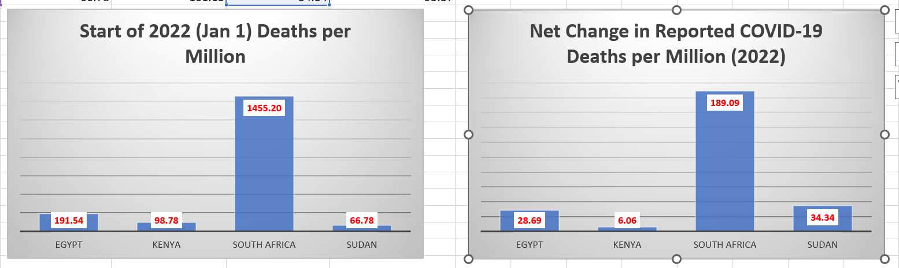

# COVID19_2022_Mortality_Analysis_In_4_Countries

https://github.com/owid/covid-19-data/blob/master/public/data/cases_deaths/total_deaths_per_million.csv 
### Data Quality & Cleaning Notes (2022)
- **Scope:** Filtered `total_deaths_per_million` across 2022 (365 daily records) for **Sudan**, **Egypt**, **Kenya**, and **South Africa**.
- **Completeness (`Blanks`):** Checked all four country columns and confirmed **zero missing/blank values** across the 365-day window.
- **Monotonicity Check (`Diff < 0`):** Computed day-over-day differences (`Current Day - Previous Day`) and filtered for values less than `0`; confirmed **zero negative values**, indicating no unexpected drops in the cumulative metric.
- **Reporting Cadence & Flat Periods (`Diff = 0`):** Observed multi-day stretches where daily differences equal `0` followed by discrete jumps/updates, reflecting a step-like ("staircase") reporting cadence rather than uniform day-by-day updates.
- **Retention & Aggregation Decision:** Retained all 365 daily records without dropping or altering flat periods to preserve authentic reporting patterns. When summarizing cumulative per-million values across time or months, used `Average` (instead of `Sum`) to prevent inflating cumulative figures.
### Why `per million` (`deaths per million`) Was Selected

Raw cumulative death counts can be misleading when comparing countries with substantially different population sizes, as larger populations naturally accumulate higher raw totals even at lower per-capita risk levels. Using **`total_deaths_per_million`** (reported deaths per million inhabitants) normalizes mortality across **Egypt**, **Kenya**, **South Africa**, and **Sudan**, enabling fair cross-country comparison on a standardized population scale and supporting clearer public health interpretation.

### 2022 Annual Comparison & Key Insights

To capture both baseline burden and within-year dynamics across all 365 days of 2022, four metrics were computed and formatted to two decimal places in `08_Start_End_2022`:

| Country | Start of 2022 (Jan 1) | End of 2022 (Dec 31) | Net Change (2022) | Annual Average (2022) |
| :--- | :---: | :---: | :---: | :---: |
| **Egypt** | 191.54 | 220.23 | 28.69 | 216.24 |
| **Kenya** | 98.78 | 104.84 | 6.06 | 104.03 |
| **South Africa** | 1455.20 | 1644.29 | 189.09 | 1609.79 |
| **Sudan** | 66.78 | 101.13 | 34.34 | 95.37 |

#### Highlights & Analytical Interpretation
- **Baseline vs. Within-Year Net Change:** Pairing side-by-side clustered column charts for **Start of 2022 (Jan 1) Deaths per Million** and **Net Change in Reported COVID-19 Deaths per Million (2022)** reveals an important distinction between cumulative burden and 2022 net velocity.
- **Sudan vs. Egypt & Kenya:** Although Egypt entered and exited 2022 with a higher cumulative rate than Sudan (`220.23` vs. `101.13` per million), Sudan experienced a larger net increase during 2022 (`+34.34` vs. `+28.69` per million), while Kenya showed the smallest net rise (`+6.06` per million). South Africa remained highest on both metrics (`1455.20` start; `+189.09` net change).

Percentage growth of death per millions in each country was calculated, with Sudan showing the highest percentage with 51% increase in the annual deaths per millions in 2022
- **Reporting Context:** Periodic step-like jumps following zero-change days ("staircase" reporting pattern) indicate batch or delayed reporting updates rather than uniform daily counts, which should be considered when interpreting short-term shifts.
